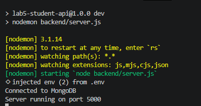
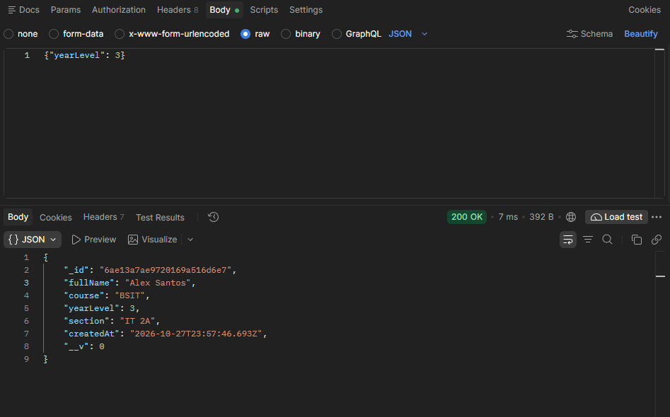
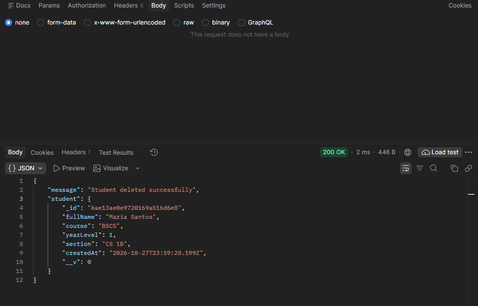
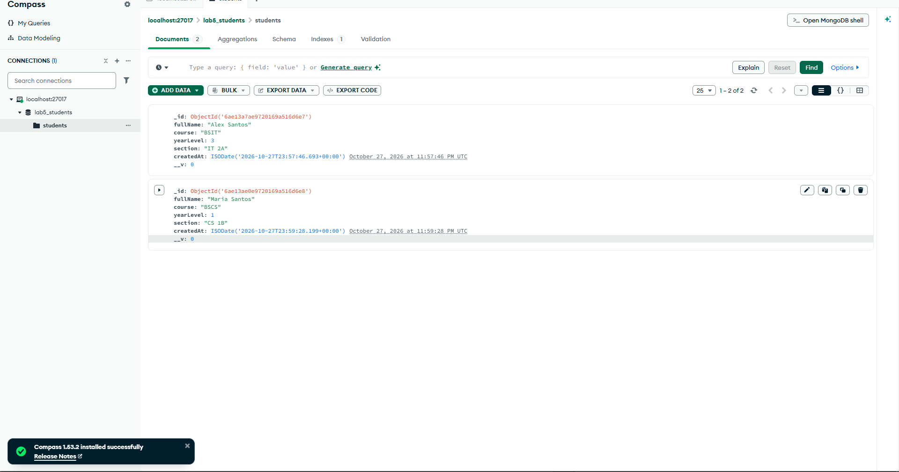
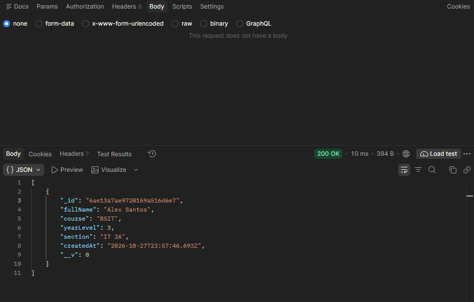

# Lab 5: Student Records REST API

A REST API for student records built with Node.js, Express, MongoDB and Mongoose.

## Setup
1. Clone the repository and run `npm install`
2. Copy `.env.example` to `.env`
3. Make sure MongoDB is running locally

## MongoDB Configuration
Set these in `.env`:
- `PORT=5000`
- `MONGODB_URI=mongodb://127.0.0.1:27017/lab5_students`

## Running the Server
- Development: `npm run dev`
- Production: `npm start`

## API Routes
| Method | Route | Description |
|--------|-------|-------------|
| GET | /api/health | Health check |
| GET | /api/students | Get all students |
| GET | /api/students/:id | Get one student (404 if missing) |
| POST | /api/students | Create a student (201) |
| PUT | /api/students/:id | Update a student |
| DELETE | /api/students/:id | Delete a student |

## Sample Request Body
{ "fullName": "Alex Santos", "course": "BSIT", "yearLevel": 2, "section": "IT 2A" }

## Screenshots

